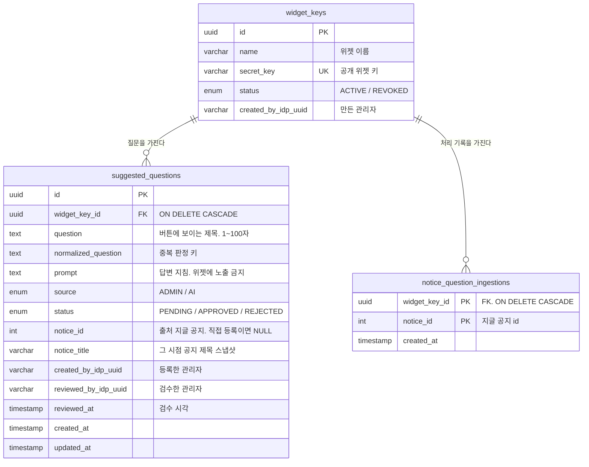

# CHA3-21 ERD — 추천 질문

`drizzle/0020_suggested_questions.sql`로 추가된 테이블 2개와, 이미 있던 `widget_keys`의 관계입니다.



## 왜 두 테이블로 나눴나

공지 하나에서 질문이 여러 개 나옵니다. 그래서 `suggested_questions.notice_id`에 유니크를 걸 수 없습니다. 걸면 공지당 질문 1개로 제한됩니다.

반대로 **"이 공지를 처리했다"는 사실은 공지당 정확히 한 번**이어야 합니다. 이 1:1을 별도 테이블로 분리했습니다.

```
공지 1건  ──┬──► suggested_questions  질문 0~N개
            └──► notice_question_ingestions  정확히 1행
```

장부를 분리하면서 얻은 것이 두 가지 더 있습니다.

- **질문이 0개 나온 공지도 기록됩니다.** 인사발령·결과발표처럼 물어볼 게 없는 공지는 LLM이 빈 배열을 돌려주는데, 장부가 없으면 "아직 안 함"과 구분되지 않아 매 주기 다시 호출하게 됩니다.
- **선점이 공짜로 됩니다.** 아래 참고.

## 제약 조건과 역할

| 제약 | 대상 | 역할 |
| --- | --- | --- |
| `notice_question_ingestions_pkey` | `(widget_key_id, notice_id)` | **선점**. `INSERT ... ON CONFLICT DO NOTHING RETURNING`으로 행을 받은 인스턴스만 LLM을 호출한다. 락을 잡지 않아 LLM 호출이 길어져도 커넥션을 붙들지 않는다 |
| `suggested_questions_widget_key_id_normalized_question_unique` | `(widget_key_id, normalized_question)` | 같은 위젯에 같은 질문이 두 번 등록되는 것을 막는다 |
| `suggested_questions_serving_idx` | `(widget_key_id, status, created_at)` | 위젯 조회용 |
| `suggested_questions_notice_id_idx` | `(notice_id)` | 공지별 질문 조회용 |
| `suggested_questions_question_length` (check) | `char_length(question) BETWEEN 1 AND 100` | 버튼 한 줄에 들어가야 한다. LLM이 긴 질문을 뱉어도 DB에서 막힌다 |

## 커서

장부에는 커서 컬럼이 따로 없습니다. `MAX(notice_id)`가 커서 역할을 합니다.

```sql
SELECT COALESCE(MAX(notice_id), 0) FROM notice_question_ingestions WHERE widget_key_id = $1;
```

`NULL`(= 행이 하나도 없음)이면 첫 실행이라는 뜻이고, 이때는 질문을 만들지 않고 지금 보이는 공지를 기준점으로만 기록합니다. 지글 검색은 최신순이 아니라 몇 년 전 공지까지 섞여 오기 때문에(실측 id 범위 88 ~ 199293), 커서 없이는 과거 공지를 계속 다시 집습니다.

## 공지 본문은 저장하지 않습니다

지글이 원본이고, 공지는 수정되거나 내려갈 수 있습니다. 복사해두면 그때부터 동기화 문제가 생깁니다. 과거에 CHA3-11(학사 공지 주기적 크롤링·누적)이 같은 이유로 취소된 이력이 있습니다.

필요한 건 두 가지뿐입니다.

- `notice_question_ingestions.notice_id` — 이 공지를 처리했는지
- `suggested_questions.notice_title` — 관리자가 검수할 때 어떤 공지였는지 (그 시점 스냅샷. 공지 제목이 바뀌어도 갱신하지 않음)

원문이 필요하면 `ZIGGLE_NOTICE_URL_BASE + notice_id`로 링크를 만듭니다.

## 상태 흐름

```
source=AI    → PENDING ──승인──► APPROVED ──► 위젯에 노출
                   │                 │
                   └──거절──► REJECTED ◄──┘

source=ADMIN → APPROVED (관리자가 직접 넣은 것은 검수 단계를 거치지 않는다)
```

위젯 조회는 `status = 'APPROVED'`만 내보내고, `prompt`는 저장소 조회 단계에서 select하지 않습니다.
