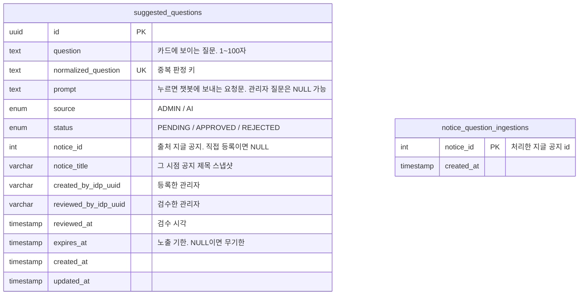

# CHA3-21 ERD — 추천 질문

`drizzle/0020_suggested_questions.sql`로 추가된 테이블 2개입니다. 다른 테이블과 외래 키로 묶지 않습니다.

추천 질문은 위젯 키에 속하지 않습니다. 질문은 공지당 한 번만 만들고, 첫 화면 API는 어느 위젯에서 불러도 같은 질문 풀에서 고릅니다(chatbot.gistory.me 한 곳에서만 쓰기로 했습니다).



## 왜 두 테이블로 나눴나

공지 하나에서 질문이 여러 개 나옵니다. 그래서 `suggested_questions.notice_id`에 유니크를 걸 수 없습니다. 걸면 공지당 질문 1개로 제한됩니다.

반대로 **"이 공지를 처리했다"는 사실은 공지당 한 번**이어야 합니다. 이걸 별도 테이블(장부)로 분리했습니다.

```
공지 1건  ──┬──► suggested_questions         질문 0~2개
            └──► notice_question_ingestions  1행
```

장부가 있어야 **질문이 0개 나온 공지도 기록됩니다.** 인사발령·결과발표처럼 물어볼 게 없는 공지는 LLM이 빈 배열을 돌려주는데, 장부가 없으면 "아직 안 함"과 구분되지 않아 매 주기 다시 호출하게 됩니다.

## 장부를 쓰는 방식

1. 주기 작업이 지글에서 최신 공지 10건을 받습니다.
2. 그중 장부에 없는 공지만 고릅니다.
3. 공지마다 질문을 만들고 저장한 **뒤에** 장부에 기록합니다.

생성이 끝난 뒤에 기록하므로, 네트워크 오류처럼 예외로 끊긴 공지는 장부에 남지 않고 다음 주기에 다시 집힙니다. 본문이 이미지뿐이거나 질문이 0개인 공지는 다시 돌려도 결과가 같아 기록합니다.

## 제약 조건과 역할

| 제약 | 대상 | 역할 |
| --- | --- | --- |
| `notice_question_ingestions_pkey` | `(notice_id)` | 같은 공지를 두 번 처리하지 않는다 |
| `suggested_questions_normalized_question_unique` | `(normalized_question)` | 같은 질문이 두 번 등록되는 것을 막는다. 공지가 겹쳐 같은 질문이 나오면 저장을 건너뛴다 |
| `suggested_questions_serving_idx` | `(status, source)` | 위젯 조회용. 출처별로 승인된 질문을 무작위로 고른다 |
| `suggested_questions_notice_id_idx` | `(notice_id)` | 공지별 질문 조회용 |
| `suggested_questions_question_length` (check) | `char_length(question) BETWEEN 1 AND 100` | 카드 한 줄에 들어가야 한다. LLM이 긴 질문을 뱉어도 DB에서 막힌다 |

## 공지 본문은 저장하지 않습니다

지글이 원본이고, 공지는 수정되거나 내려갈 수 있습니다. 복사해두면 그때부터 동기화 문제가 생깁니다. 과거에 CHA3-11(학사 공지 주기적 크롤링·누적)이 같은 이유로 취소된 이력이 있습니다.

필요한 건 두 가지뿐입니다.

- `notice_question_ingestions.notice_id` — 이 공지를 처리했는지
- `suggested_questions.notice_title` — 관리자가 검수할 때 어떤 공지였는지 (그 시점 스냅샷. 공지 제목이 바뀌어도 갱신하지 않음)

관리자 상세 응답의 원문 링크는 `ZIGGLE_NOTICE_URL_BASE + notice_id`로 만듭니다.

## 상태 흐름

```
source=AI    → PENDING ──승인──► APPROVED ──► 위젯에 노출 (expires_at 전까지)
                   │                 │
                   └──거절──► REJECTED ◄──┘

source=ADMIN → APPROVED (관리자가 직접 넣은 것은 검수 단계를 거치지 않는다)
```

직접 등록하거나 승인할 때 `expires_at`을 반드시 정합니다(무기한이면 `NULL`).

위젯 조회는 `status = 'APPROVED'`이고 기한이 지나지 않은 질문만, 관리자 질문 2개와 공지 질문 2개를 무작위로 골라 `{ id, question, prompt, source }`로 내보냅니다.
